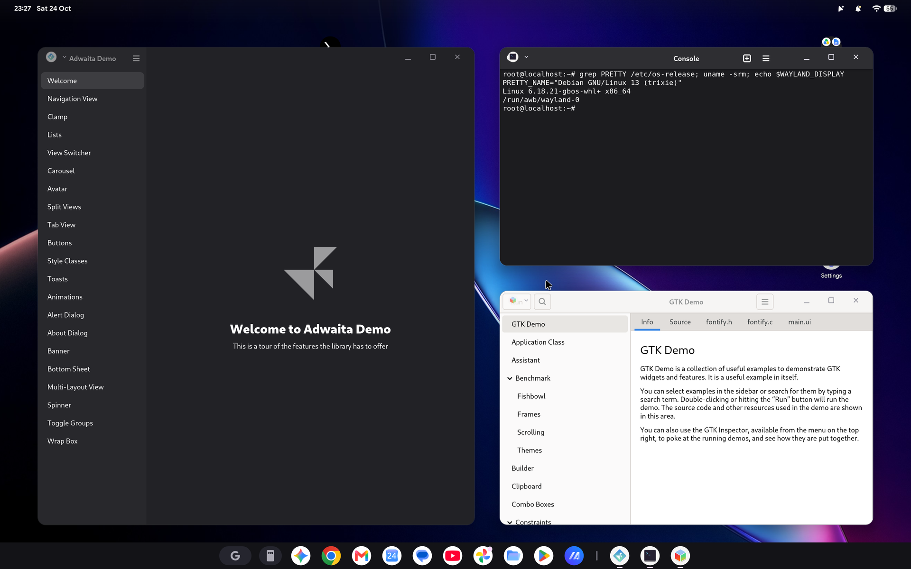
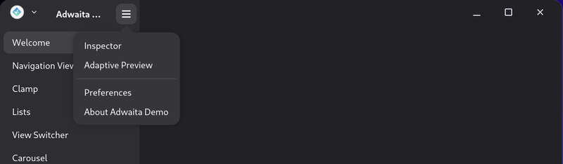

# Android Wayland Bridge

A Wayland compositor as an Android app. Each Linux toplevel opens as its own
Android desktop window, and apps draw their header bar into Android's
transparent caption. See [docs/DESIGN.md](docs/DESIGN.md).



Popovers and menus open from the header bar like on any Linux desktop:



## Compared with Android's Linux Terminal

Android's own Linux Terminal now has an experimental setting, "Wayland GUI
apps in multi-window", that also opens each Linux window as an Android
window. It needs no root and ships with the OS, so try it first. Tested on
a Googlebook 14 (Terminal build CL3B.260622.276, October 2026), it differs
from this bridge, which runs Linux either in a chroot (root) or in its own
VM (no root, see [Linux in a VM](#linux-in-a-vm-no-root)), in these ways:

| | Linux Terminal | This bridge: chroot | This bridge: VM |
|---|---|---|---|
| Needs root | No | Yes | No (three adb commands) |
| Buffers | Shared memory only | Shared memory and dmabuf, with explicit sync (`linux-dmabuf`, `linux-drm-syncobj`) | Shared memory, through waypipe over vsock |
| App rendering | Software (llvmpipe) | GPU (Mesa's Vulkan and GL drivers) | Software (llvmpipe) |
| Scaling | Integer only, so GTK3 draws at 1x | Fractional (`wp_fractional_scale_v1`), pixel-exact | Fractional |
| Decorations | A second title bar under Android's | Header bars drawn into Android's caption (`xdg-decoration`) | Header bars in Android's caption |
| On-screen keyboard and IME | No `text-input` | `text-input-v3` | `text-input-v3` |
| Pointer lock for games | No | `pointer-constraints`, `relative-pointer` | Yes |
| Launcher icons | One Terminal icon for every window | One icon per Linux app (stub apps) | One icon per app (installing them needs root) |
| Escape key | Acts as Back and closes the window | Sent to the app | Sent to the app |

Both modes reach the display's 90 fps with `weston-simple-egl` on that
device, as the Terminal does. The VM mode cannot use the Terminal's faster
path into crosvm (its Wayland socket): SELinux lets crosvm connect only to
the Terminal's own socket.

The Terminal's bridge also leaks one file descriptor per frame and crashes
after about six minutes of animation (with the VM), and every window opens
at the same spot. The Terminal does have a hidden gfxstream mode
(`acceleration_type`) that gives the VM the host GPU through Vulkan, but
only for off-screen work: with no dmabuf in the bridge, windows still draw
in software.

## Build and run

Requirements: Android SDK (platform 37), NDK r30, Rust with
`x86_64-linux-android` and `x86_64-unknown-linux-gnu` (the VM's guest
agent), `cargo-ndk`, and Python 3 and curl (the build fetches and builds
waypipe).

```bash
./scripts/deploy.sh
```

`deploy.sh` builds the APK and installs it. It then restarts the compositor
service and pushes the chroot launcher to the device. `ADB_SERIAL` selects
the device.

On the device, as root, run any Wayland app from the Debian chroot:

```bash
adb shell /data/local/tmp/awb-run.sh adwaita-1-demo
```

Each Linux app gets its own launcher icon, a stub app that the device makes
itself (name and icon from the chroot's desktop file): within seconds of
the app first opening a window, or of its installation in the chroot.
The root launcher (`awb-launcher.sh`) also remakes stubs when an app or
dev.awb changes and removes them with their app. It signs them with the
debug key, which `deploy.sh` puts in `/data/adb/awb` (root only). For SVG
icons the chroot needs librsvg's renderer (`apt install librsvg2-bin`),
else the stub gets a default icon. Stubs carry no window code: they run
dev.awb's, so updating dev.awb updates every stub. To build one on the host
instead (Gradle):

```bash
./scripts/install-stub.sh org.gnome.Adwaita1.Demo
```

See [Stub apps](docs/DESIGN.md#stub-apps).

The icon starts the app through `awb-launcher.sh` (the root side, started by
`deploy.sh`, which also runs the helper that moves windows when an app asks
to, as on a title-label drag). The app's windows then open as the stub's tasks, so the
taskbar and recents show them under that app.

Links cross over both ways. Web links that a Linux app opens (`xdg-open`,
`$BROWSER`) open in Android's browser. Links in an app's own URL schemes
(the `x-scheme-handler` types in its desktop file, such as `claude://`)
open in the app, through its stub. That is how a browser sign-in returns
to the app.

For GPU rendering in the apps, the chroot needs Mesa's drivers
(`apt install mesa-vulkan-drivers libgl1-mesa-dri`). The compositor itself
composites with Vulkan; `renderer=cpu` in the app's `files/awb.properties`
switches back to the CPU compositor.

Games and 3D apps can lock the pointer (`zwp_pointer_constraints_v1`):
the window then takes Android's pointer capture, which ends when it loses
focus (Meta or Alt+Tab); a click back into the window locks it again.
Stub apps built before stubs ran dev.awb's code (format 1) lack pointer
lock, touchpad scrolling and full-rate motion until the root launcher
remakes them (`deploy.sh` has it sync at once).

Electron apps lay their title bar out around Electron's own buttons, not
Android's. For Claude Desktop, `./scripts/patch-claude-desktop.sh` patches
its `app.asar` to keep clear of Android's caption controls; rerun it after
Claude Desktop updates.

## Linux in a VM (no root)

Without root, dev.awb runs Linux in its own VM through Android's
Virtualization Framework, the same Debian image as the Linux Terminal's.
Grant it the VM permissions (development permissions, so adb can, without
root) and let it call the framework's system APIs:

```bash
adb shell pm grant --user 10 dev.awb android.permission.MANAGE_VIRTUAL_MACHINE
adb shell pm grant --user 10 dev.awb android.permission.USE_CUSTOM_VIRTUAL_MACHINE
adb shell settings put global hidden_api_policy 1
```

(`--user 10` is the desktop user on a Googlebook; use your own.) Then
open Wayland Bridge: it downloads the image (about 620 MB, from
`dl.google.com`), and starts and stops the VM; the page lists any of the
steps above that are missing. On first boot the guest installs
`awb-display`, dev.awb's guest agent, and waypipe.

Run apps in the VM with `awb-run`:

```bash
awb-run gnome-text-editor
```

Their windows come over vsock through waypipe (Android drops connections
from the VM to apps, so the app connects in, and the guest agent pairs each
app with a waiting connection). The guest agent also gives them Android's
dark mode and accent colour (a settings portal), the caption's header bar
spacing, and Android's browser for web links. With root, each VM app also
gets its own launcher icon (`dev.awb.vm.*` stubs, apart from the chroot's),
which starts the VM if needed. To log in over SSH, put a public key line in
`files/awb.properties` as `vm_ssh_key=` before the first boot. See
[VM guest agent](docs/DESIGN.md#vm-guest-agent).

## Layout

- `native/`: the compositor (Rust, `wayland-server`), built as `libawb.so`.
- `app/`: the Kotlin layer: compositor callbacks, displays, the window
  session service.
- `window/`: the window activity (insets, input, surface), shared by `app/`
  and the stubs; it talks to the compositor over binder.
- `stub/`: the app of one Linux app (launcher icon, window tasks); its
  activities' code is loaded from dev.awb at run time. Its template build,
  shipped in dev.awb, is what the device makes stubs from.
- `scripts/`: deploy loop, chroot and app launchers, stub making and sync
  (`awb-stubs.sh`, on the device), the host stub build and the waypipe
  build.
- `vm/`: the VM guest's side: `awb-display`, the guest agent (Rust), and
  `awb-run`.
- `tools/torture/`: a misbehaving client for robustness tests. Build it with
  `cargo build --release --target x86_64-unknown-linux-musl`.

## License

MIT. See [LICENSE](LICENSE).
